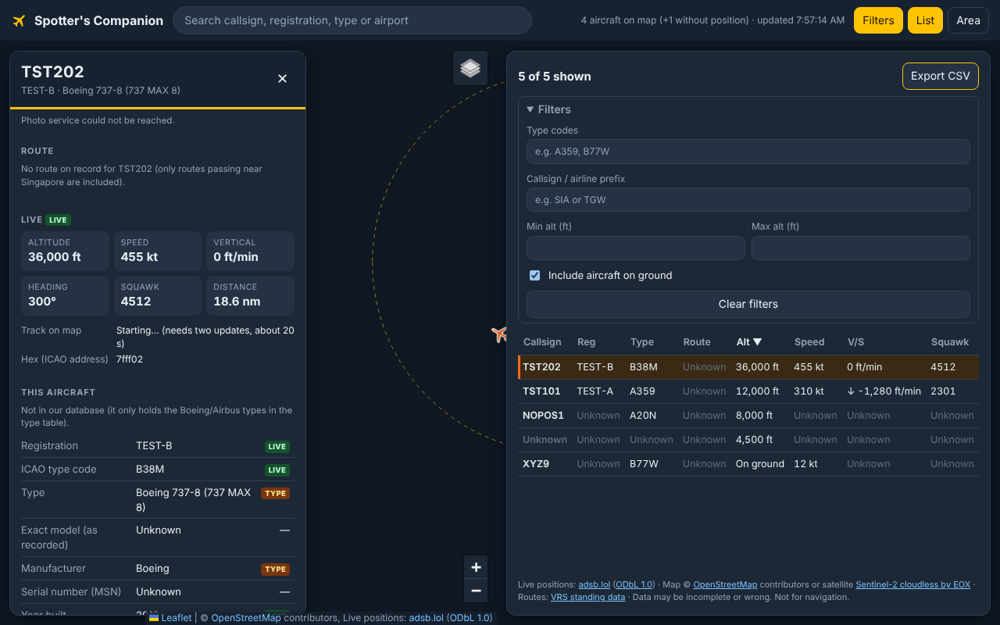
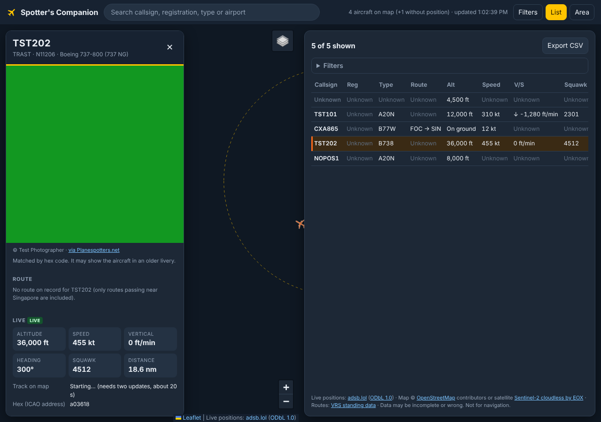
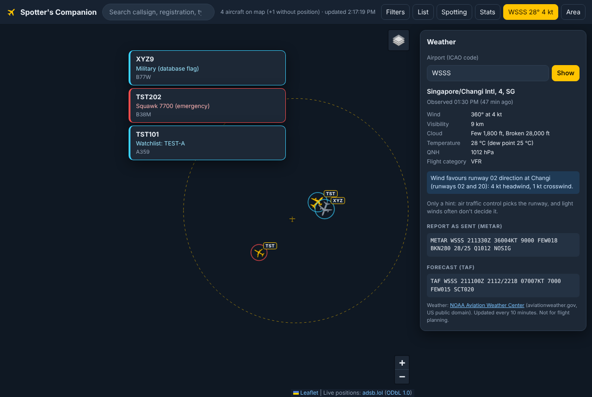
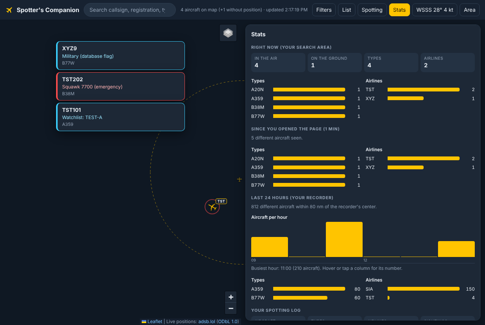

# SkyWatch SG

(Formerly "Spotter's Companion".)

A personal, non-commercial hobby project by an aviation enthusiast: a live map of nearby aircraft built only on
free, open data. It gives you some features that paid flight trackers charge for:

- **Live map** (Phase 1): aircraft around a point (default: Singapore, 1.35, 103.82), with plane icons
  rotated to their direction of travel. Click a plane for callsign, registration, type, altitude,
  speed, vertical speed and squawk.
- **Distance and times:** the flight card shows the route's great-circle distance (e.g. LHR → SIN 5,877 nm /
  10,883 km); flights with a stop (e.g. QF1 SYD → SIN → LHR) list each leg separately plus the total, with
  the leg being flown marked. It also shows the distance still to fly, an **estimated** arrival time (distance to go ÷ current ground speed),
  and the departure time **only if the app saw the takeoff** (in a recorded or live track). There is no
  schedule data, so scheduled/actual gate times aren't available.
- **Flight routes:** origin, stops and destination for each callsign (e.g. CXA865 FOC → SIN) in the
  list, hover label, flight card and CSV. A "(?)" warns when the plane isn't near the route on record.
- **Liquid-glass interface:** the map fills the screen and everything floats above it on translucent glass (`css/glass.css`), in dark or light to match your device (the map starts on Streets in light mode). On phones the panel buttons form a floating tab bar at the bottom, which steps aside when a flight card is open. Inspired by Apple's current design language; all icons are this project's own drawings.
- **Dark, map-first interface** (inspired by flight-tracker apps like Plane Finder): full-screen map,
  yellow planes, a search box, and a flight card with a big route display, progress bar and live tiles.
  Works on phones too: the card becomes a bottom sheet.
- **Aircraft silhouettes and airline badges:** each plane is drawn as its kind of aircraft (narrowbody,
  widebody, four-engine, A380, trijet, turboprop, business jet, light plane, helicopter; original drawings in
  `js/shapes.js`), with its airline's code (e.g. SQ, TR, EK) in a small badge. The airline name also appears in
  the hover label and the flight card. Real airline logos aren't used: they're copyrighted trademarks with no
  open licence. Badges can be switched off in Filters.
- **Icons sized by aircraft class:** from the ADS-B emitter category each aircraft broadcasts (light,
  small, large, 757-class, heavy, helicopter); the A380 is biggest. No category = medium size.
- **Map styles (layers button):** **Dark** (default) and **Streets** are sharp vector maps from
  OpenFreeMap, drawn by MapLibre, so text and roads stay crisp at every zoom and on Retina screens.
  **Satellite** is Sentinel-2 imagery, and **Classic** is the plain OpenStreetMap image map. If a browser
  can't run MapLibre (no WebGL), the app falls back to Classic.
- **Flight tracks:** select a plane (on the map or in the list) to see where it has flown, coloured
  by altitude. Click empty map to hide it. A small recorder on Cloudflare keeps 24 hours of positions
  around Singapore, so tracks include where the plane was before you opened the page (see `proxy/README.md`).
- **Filters, list and CSV** (Phase 2): filter by type codes, altitude range, or callsign/airline prefix.
  A sortable list opens from the **List** button, filters from **Filters**, and you can export the current view as CSV.
- **Type and engine table** (Phase 3): 58 Boeing and Airbus airliner types in `data/aircraft_types.json`,
  each with its engine options and sources.
- **Aircraft info panel** (Phase 4): a photo from Planespotters.net (credited to its photographer), registration, type, exact model, manufacturer and
  engines. Every value is tagged with where it came from (LIVE / DB / OSN / VRS / TCDS / TYPE), and
  missing values show "Unknown".
- **Spotting: watchlist, alerts and your log.** Add registrations, types, callsign prefixes or hex codes to a
  watchlist, and get a pop-up (and a pulsing ring on the map) when one turns up. Alerts can also fire for
  types on your own "rare" list, aircraft the community database flags as military or "interesting", and
  emergency squawks (7500 hijack, 7600 radio failure, 7700 emergency, shown in red). Press **Log as seen** on a
  flight card to keep a spotting log (with dates and how many times you've seen it), and export it as CSV.
  Everything stays in your browser; nothing is uploaded.
- **Stats:** what's flying right now (types, airlines, in the air vs on the ground), everything seen since you
  opened the page, the last 24 hours from your recorder (aircraft per hour, top types and airlines), and
  totals for your log.
- **Weather:** the latest METAR for any airport (default Changi, WSSS), decoded into wind, visibility, cloud,
  temperature and QNH, plus the raw report and the TAF forecast. For Changi it also says which runway direction
  the wind favours. The top-bar button shows a summary (e.g. `WSSS 28° 4 kt`).

## Screenshots

> These were taken by the automated tests with **synthetic test data**: made-up positions and
> `TEST-` registrations. Map tiles were blocked in the build environment, so the background is
> grey. Replace them with real screenshots once you run the app yourself.

| Map, list and filters | Aircraft info panel |
|---|---|
|  |  |

| Alerts and Weather (real Changi METAR from 21 Oct 2026) | Stats |
|---|---|
|  |  |

## Install it as an app

It's a web app, so there's nothing to download from an app store. Open
https://themagicianleo.github.io/spotter-companion/ and:

- **iPhone / iPad (Safari):** tap the **Share** button, then **Add to Home Screen**, then **Add**.
- **Android (Chrome):** tap the **⋮** menu, then **Add to Home screen** or **Install app**.
- **Mac / PC (Chrome or Edge):** click the install icon at the right end of the address bar.

It then opens full-screen from its own icon, called "SkyWatch". It still needs the internet (it shows live
data), and updates arrive by themselves, because nothing is cached for offline use. Your watchlist and log are
kept separately for the installed app and the browser tab, so on an iPhone, start your log in the one you'll use.
The icon (`icons/icon.svg`) is an original drawing made from the app's own map plane.

## How to use it

- **Click a plane** (or a row in the list) to open its flight card; click empty map to close it and hide its track.
- **Hover** over a plane for a quick label: callsign, type, route, altitude.
- **Search** (top bar) matches callsign, registration, type code or airport code, e.g. `SIA`, `9V-`, `A359` or `SIN`.
- **List**, **Filters** and **Area** (top right) open the aircraft list, the filters and the search-area settings.
- **Spotting** holds the alert switches, watchlist, rare-type list and your log. Click a pop-up (or a name under
  "Matching right now") to jump to that plane.
- **Stats** and **Weather** open those panels.

## How to run it

You need Python 3, which most computers have. Nothing to install.

```bash
cd spotters-companion
python3 scripts/dev_server.py
# then open http://localhost:8000
```

`dev_server.py` serves the files and also **relays** the API requests (see "CORS" below), so the
app works on your computer even if the provider blocks direct browser requests.
Opening `index.html` by double-clicking it won't work: browsers block JavaScript modules on `file://` pages.

### Put it on GitHub Pages

Push the repo to GitHub, then go to **Settings → Pages → Deploy from branch → main / root**.
There's no build step.

**CORS:** a third-party page says adsb.lol doesn't send the `Access-Control-Allow-Origin`
header, which would stop a page on another site from reading its data. So the public site calls
adsb.lol through a small relay: the Cloudflare Worker in [`proxy/`](proxy/README.md), set as
`publicProxyBase` in `js/config.js`. If you fork this project, deploy your own relay and change
both `publicProxyBase` and `ALLOWED_ORIGIN`.

### Tests

```bash
npm test             # unit tests: API parsing, filters, sorting, CSV, type table rules (no install needed)
npm run test:e2e     # browser tests (needs Playwright: npm install --no-save playwright)
```

### Settings

Everything adjustable is in [`js/config.js`](js/config.js): default center, radius, polling interval
(10 s), the 1-request-per-second floor, cache time, and which provider to use.

### Update the aircraft database

```bash
python3 scripts/build_aircraft_db.py   merges tar1090-db + OpenSky into data/aircraft_db/ (run monthly by GitHub Actions)
scripts/parse_tcds.py          builds data/aircraft_variants.json from the TCDS text
scripts/tcds_sources.txt       which TCDS documents to fetch
.github/workflows/             build-aircraft-db.yml (monthly DB rebuild), fetch-tcds.yml (TCDS PDFs -> text)
```
This downloads the latest tar1090-db and OpenSky aircraft database and rebuilds `data/aircraft_db/`
with only the types in the type table. GitHub Actions also does this automatically on the 2nd of
every month (`.github/workflows/build-aircraft-db.yml`). To rebuild the certified-engine table, see the
comment at the top of `scripts/parse_tcds.py`.

## How it's organised

```
index.html, css/style.css
js/config.js       all settings
js/api.js          the ONLY file that talks to live-data providers (switch providers here)
js/app.js          polling loop, back-off after errors, error banner, center/radius controls
js/map.js          Leaflet map and rotating plane markers
js/filters.js      filter + sort logic (pure functions)
js/list.js         the sortable table
js/csv.js          CSV export
js/aircraftDb.js   cached lookups in data/aircraft_db/ and data/aircraft_types.json
js/infoPanel.js    the aircraft info panel
js/photos.js       aircraft photos from Planespotters.net
js/track.js        remembers positions so the map can draw tracks
js/routes.js       flight routes by callsign, with a plausibility check
js/airlines.js     airline name and code from the callsign
js/shapes.js       aircraft silhouettes for the map icons
js/format.js       turns values into text, with "Unknown" for anything missing
js/spotting.js     watchlist, alert rules and seen log (pure functions, saved in localStorage)
js/spottingUI.js   the Spotting drawer, alert pop-ups and the card's "Log as seen" bar
js/flags.js        military / "interesting" flags (data/aircraft_flags.json)
js/stats.js        counting for the Stats panel (pure functions)
js/statsUI.js      the Stats drawer and its bar charts
js/weather.js      METAR/TAF fetching and decoding (aviationweather.gov, via the relay)
js/weatherUI.js    the Weather drawer and top-bar summary
js/main.js         wires everything together
data/aircraft_types.json   type + engine table (Phase 3)
data/aircraft_variants.json exact model -> certified engines, parsed from official TCDS
data/routes.json           routes near Singapore (scripts/build_routes.py)
data/aircraft_db/          airliner-only extract of tar1090-db (Phase 4)
data/aircraft_flags.json   hex codes tar1090-db flags as military or "interesting" (scripts/build_aircraft_db.py)
scripts/dev_server.py      local server + relay
scripts/build_aircraft_db.py
proxy/                     Cloudflare worker: relay + flight recorder (setup steps in proxy/README.md)
vendor/leaflet/            Leaflet 1.9.4 (copied in so the site needs no CDN)
tests/                     unit + browser tests (the fixture is synthetic, and labelled so)
```

**Dependencies** (all vendored in `vendor/`, so the site needs no CDN):
- **Leaflet 1.9.4** (BSD-2-Clause): the map library.
- **MapLibre GL 5.24.0** (BSD-3-Clause, about 280 KB compressed): draws the sharp vector maps.
- **@maplibre/maplibre-gl-leaflet 0.1.4** (ISC): lets Leaflet show a MapLibre map as a layer.
 Python 3 (standard library only) is used for the dev server and the database
build script. Playwright is only needed if you want to run the browser tests.

## Data sources, terms and attribution

I researched these on 21 Oct 2026. The build environment couldn't open most provider websites
directly, so some terms come from search-result summaries. **Re-read the providers' own terms
before you publish.**

| Source | Used for | Key? | Rate limit | Terms | Attribution |
|---|---|---|---|---|---|
| [adsb.lol](https://adsb.lol) `api.adsb.lol/v2/point` (default) | Live positions | No (a feeder-earned key is "planned") | "Dynamic based on load". The app polls every 10 s, never faster than 1/s, and backs off on 429 | Data under [ODbL 1.0](https://opendatacommons.org/licenses/odbl/1-0/). The docs mark the open API "deprecated" in favour of a feeders-only API; the public endpoint still worked in Oct 2026 reports | Shown on the map, in the footer and in CSV exports |
| [airplanes.live](https://airplanes.live) (optional, in `api.js`) | Live positions | No | 1 request/s | Non-commercial. ⚠ An Oct 2026 report says feeders-only since Aug 2026 | Shown when selected |
| [OpenFreeMap](https://openfreemap.org) vector maps ("dark", "liberty" styles) | Dark and Streets map backgrounds | No | No limits on the public instance | Free; map data © OpenStreetMap (ODbL), OpenMapTiles (BSD/CC BY 4.0), styles MIT/BSD/CC BY | "OpenFreeMap © OpenMapTiles Data from OpenStreetMap" on the map |
| [OpenStreetMap](https://www.openstreetmap.org/copyright) tiles | Map background | No | [Tile usage policy](https://operations.osmfoundation.org/policies/tiles/) | ODbL | "© OpenStreetMap contributors" |
| [EOX Sentinel-2 cloudless 2024](https://s2maps.eu) tiles | Satellite background (Map/Satellite switch) | No | Not published | [CC BY-NC-SA 4.0](https://creativecommons.org/licenses/by-nc-sa/4.0/): free for non-commercial use with attribution; commercial use needs an EOX licence | "Sentinel-2 cloudless by EOX IT Services GmbH (contains modified Copernicus Sentinel data 2024)" shown on the map |
| [tar1090-db](https://github.com/wiedehopf/tar1090-db) (from the [Mictronics](https://www.mictronics.de/aircraft-database/) database) | Registration, type, year, operator | No | Static file | ⚠ **No license file found**; terms unclear (see Limitations) | Shown in the info panel |
| [NOAA Aviation Weather Center data API](https://aviationweather.gov/data/api/) `/api/data/metar`, `/api/data/taf` | METAR and TAF in the Weather panel | No | Docs: "maximum 100 requests per minute", set a custom User-Agent. The app asks once per 10 minutes per airport, and the worker caches answers for 5 minutes | [NWS disclaimer](https://www.weather.gov/disclaimer): public domain; don't present modified data as official, don't imply endorsement. The docs say CORS isn't permitted, so it goes through the relay | "Weather: NOAA Aviation Weather Center … Not for flight planning" in the panel |
| [tar1090-db](https://github.com/wiedehopf/tar1090-db) flags column | Military / "interesting" alerts (`data/aircraft_flags.json`) | No | Static file (rebuilt monthly) | Same as tar1090-db below (licence unclear) | Named in the Spotting panel |
| [Wikimedia Commons](https://commons.wikimedia.org) API (`action=query`, the airframe's category `"<registration> (aircraft)"` plus a file search with the registration in the title, merged and sorted newest first by `DateTimeOriginal`) | More photos ("+N" on the preview, strip in the full card, full-screen viewer) | No | No fixed limit; at most 2 small requests per aircraft, cached, with an `Api-User-Agent` header as Wikimedia asks | Each photo's own free licence (CC BY, CC BY-SA, CC0, public domain…): author and licence must be shown | "© author · licence (linked) · Wikimedia Commons" (linked to the file page) on every photo in the viewer |
| [Planespotters.net](https://www.planespotters.net) photo API `api.planespotters.net/pub/photos/hex/{hex}` | Aircraft photo in the info panel | No | Not published. One lookup per aircraft per visit, cached in memory | [Terms of use](https://www.planespotters.net/legal/termsofuse): photos belong to the photographers; must show "© photographer" and link to the photo page; hotlink only, never re-host | "© name · via Planespotters.net" under each photo, and the photo links to its page |
| [OpenSky Network aircraft database](https://opensky-network.org/data/aircraft) (monthly snapshot, merged by the build) | Exact model (e.g. A320-251N), serial number, build year, engine as recorded | No | Static file | OpenSky says the aircraft database is not covered by its terms of use (search summary; page not reachable from the build environment) | "OSN" tag on each value |
| Official type certificate data sheets (EASA, UK CAA), as text on the `tcds-text` branch | `data/aircraft_variants.json`: engines certified for each exact Airbus/A220 model | No | – | Public regulatory documents | "TCDS" tag; document name and text line number shown in the panel |
| [Virtual Radar Server standing data](https://github.com/vradarserver/standing-data), aircraft files | Operator, serial number, year built, exact model (aircraft corrected by VRS users since 2022) | No | Static file (merged into `data/aircraft_db/` monthly) | [CC0 1.0](https://creativecommons.org/publicdomain/zero/1.0/) | "VRS" tag on each value |
| [Virtual Radar Server standing data](https://github.com/vradarserver/standing-data) (routes + airports; also used by adsb.lol) | Flight routes: callsign → origin, stops, destination | No | Static file (`data/routes.json`, rebuilt monthly) | [CC0 1.0](https://creativecommons.org/publicdomain/zero/1.0/): no restrictions | "ROUTE" tag in the panel (credited even though CC0 doesn't require it) |
| [Virtual Radar Server standing data](https://github.com/vradarserver/standing-data), airlines file | Airline name and IATA code from the callsign (`data/airlines.json`) | No | Static file (rebuilt monthly) | [CC0 1.0](https://creativecommons.org/publicdomain/zero/1.0/) | Credited with the routes |
| `data/aircraft_types.json` (my own table) | Model names, engine options | – | – | Built from EASA/FAA type certificate data sheets, regulator notices and manufacturer pages, each cited per row | Sources listed in the panel |
| [airfleets.net](https://www.airfleets.net) | **Link only**: "More about … on airfleets.net" opens its search for the registration in a new tab | – | Nothing is fetched or copied; it's an ordinary link | No open licence or API, so its data is not used in the app | – |

**Not used:**
- **OpenSky Network** for live data. Its terms require a written agreement for "operational" use
  in a live product. Accounts need OAuth2 secrets, which a static site can't hide. Anonymous use is
  400 credits/day, about an hour of 10-second polling. (Citation, if you use OpenSky data elsewhere:
  M. Schäfer et al., "Bringing Up OpenSky: A Large-scale ADS-B Sensor Network for Research", IPSN 2014.)
- **The OpenSky aircraft database** would add serial numbers, but I couldn't download it to check its real fields.
- **Flightradar24** or any other site whose terms forbid scraping.

**No secrets:** none of the providers used need a key. `.env` is in `.gitignore` in case one is ever added.
Remember that a static site can't keep any key secret.

## Limitations (please read)

- **The response format was first worked out from source code, then confirmed live.** The build
  environment couldn't reach any provider, so the format came from the source code of adsb.lol's
  API and readsb. A real response fetched through the relay on 21 Oct 2026 (14 aircraft near
  Singapore) matched it: `{"ac": [...], "msg": "No error", "now", "total", "ctime", "ptime"}`.
  It also showed `calc_track`, which is now used as a fallback direction. The automated tests
  still use a synthetic fixture.
- **The public site goes through a relay.** It calls adsb.lol through a Cloudflare Worker
  (`publicProxyBase` in `js/config.js`, code in `proxy/`), in case adsb.lol doesn't allow
  direct browser requests (CORS). Whether direct calls would work was never tested.
- **airplanes.live may now be feeders-only**, and its response format wasn't verified. The app shows
  an error rather than guessing if the format differs.
- **Serial number, year built, age and operator are not shown.** The free databases had them for too few
  aircraft (e.g. 66 of 299 Singapore-registered aircraft had a build year), so they were removed from the
  card. Missing fields that remain are listed on one line. When sources disagree on the exact model
  (e.g. E195-E2 vs E190-E2), the card shows both.
- **Every Singapore-registered (9V-) aircraft is in the database**, whatever its type; other countries'
  aircraft only if they're one of the Boeing/Airbus types in the type table.
- **Exact model and certified engine are often missing.** These come from OpenSky's
  community database (August 2025 snapshot). For Airbus types, about 63% of aircraft get an exact
  certified engine. The table covers Airbus and A220 models (104 models from the official type
  certificates); Boeing model numbers are customer codes that don't identify the engine. When a model
  lists several engine versions (thrust ratings or modifications), the panel shows them all, because the
  database doesn't say which one an airframe has. For types with only one engine (e.g. 737 MAX 8, 777-300ER),
  the panel says that engine applies.
- **OpenSky model strings are tidied before matching.** Text in brackets and an "SL" suffix are removed,
  and one trailing E/X/F is dropped if needed (e.g. "A330-343E" is matched to the certified "A330-343").
  The panel always shows the original text.
- **Database licence is unclear.** tar1090-db has no licence file, and I couldn't find the Mictronics
  database terms. The repo includes an airliner-only extract (36,306 aircraft). If you're unsure,
  delete `data/aircraft_db/` and the panel will still work using the live feed's own
  registration/type fields.
- **Engine data was verified through search-result excerpts**, not by reading each TCDS PDF.
  These options are marked `verified: false` and shown as "unconfirmed" in the panel. Check them:
  - A19N: PW1100G-JM · A30B: JT9D-59A · A306: JT9D-7R4 · A310: JT9D-7R4, CF6-80A
  - B74S: all (JT9D, RB211-524) · B762: JT9D-7R4 · B763: PW4000 · B764: all (CF6-80C2, PW4000)
  - B77L: GE90-115B · B773: GE90 · B778/B779: GE9X · B788/B789: GEnx-1B
- **ICAO codes:** all 53 codes in the original list exist in tar1090-db with the expected names.
  Added: B732, A30B, B74S, B778, B779. I couldn't open ICAO Doc 8643 itself, so I checked against an
  FAA order that reproduces it, plus search results.
- **Only one Planespotters photo per aircraft.** Their free API returns a single photo (checked on 11 aircraft, 22 Oct 2026). Which photo Planespotters picks isn't documented and it gives no date. Extra photos come from Wikimedia Commons, matched by registration and sorted by the date each was taken (shown on each photo; undated ones last), so popular airframes have several and many have none; registrations are sometimes reused, so an old photo may show a different aircraft (the viewer says so). Flightradar24's galleries come from JetPhotos, which has no public API.
- **Photos:** I couldn't open Planespotters' API documentation, so the response fields were first taken
  from two open-source projects' parsers. A real response through the relay (21 Oct 2026, 9V-SJA)
  then confirmed them. Photos are matched by hex code and may show an
  older livery. The app asks Planespotters directly first and falls back to the relay, which sends a
  User-Agent with this repo's URL as contact information.
- **Tracks are regional, not whole flights.** The recorder only covers 80 nm around Singapore, saves
  one position per minute (so older parts of a track are less detailed), and keeps 24 hours. The page
  shows up to 3 hours of it, and drops any part separated by more than 5 minutes (e.g. an earlier
  flight of the same aircraft). Without the recorder (or on localhost), tracks start when you open the page.
- **Satellite imagery is about 10 m per pixel** (Sentinel-2), so you'll see airports and runways but not
  individual aircraft. Sharper imagery (Esri, Google, Mapbox) needs an account or key, or doesn't
  allow this use. The EOX tile URL comes from third-party listings, so check that the Satellite
  view loads.
- **Routes are looked up by callsign** in a crowd-sourced database, which can be outdated or missing
  (airlines reuse flight numbers). Like adsb.lol, the app checks the route is plausible: the plane must be
  within 50 nm, or 20% of the leg length, of the straight line between airports. Otherwise it shows "(?)"
  and a warning. Only routes passing within 300 nm of Singapore are included (8,739 of ~620,000), and
  callsigns using IATA airline codes aren't converted to ICAO.
- **Engine options are per type, never per aircraft.** The app never claims which engine a specific airframe has.
- **Simplifications:** positions refresh every 10 s, so markers jump instead of gliding.
  Aircraft without a position are listed but not drawn. Polling pauses while the tab is hidden.
- **Military and "interesting" alerts come from a community flag list** (tar1090-db: 23,084 military and 42
  "interesting" hex codes in Oct 2026). Many military aircraft aren't in it, and some entries can be wrong.
  The database's privacy flags (PIA, LADD) aren't copied or used.
- **The "rare types" starter list is my own choice, not data.** What's rare depends on where you spot; edit it.
- **Emergency alerts use the squawk code and the `emergency` field the aircraft sends.** A 7700 can be a
  test or a mistake; check real news before assuming anything.
- **Your watchlist and log live in this browser only** (localStorage). Clearing site data, private browsing
  or another device means an empty log; export it as CSV now and then to keep a copy.
- **Background notifications** only work while the page is open in a tab, and only if you allow them.
  Some phones only allow notifications from installed apps; the in-page pop-ups still work.
- **Weather goes through the relay.** aviationweather.gov doesn't allow browser requests from other sites
  (CORS), so the worker must include it in `ALLOWED_HOSTS` (update the worker, see `proxy/README.md`).
  Reports are cached for 10 minutes. The JSON fields were checked against a real response (21 Oct 2026);
  gusts, weather (e.g. `-TSRA`) and CB clouds are read from the raw report. **Not for flight planning.**
- **The runway hint is only the wind's preference** for Changi's runway 02 or 20 direction. Air traffic
  control decides, and in light winds the wind doesn't settle it. Other airports get no hint, because I
  haven't added their runway directions.
- **24-hour stats need the updated worker.** Snapshots taken by the old worker have positions only, so types
  and airlines appear from the moment the new worker starts recording them.
- **Not for navigation or safety use.** Data is crowd-sourced and can be missing, late or wrong.

## How AI was used

This project was built with an AI coding assistant (Claude, by Anthropic). I set the goals, the
hard rules (open data only, no invented fields, cite every source) and the phases.

The assistant:
- researched provider terms and documentation
- read the adsb.lol and readsb source code to find the real response format
- inspected the real tar1090-db file
- researched engine data
- wrote the code, comments and tests

The assistant also flagged what it could *not* verify. Those items are listed under Limitations
above and marked in the data. I'm responsible for checking those items and for reviewing the code.
